# Radar de Creadores · Creator Radar

**[Español](#español) · [English](#english)**

Métricas y tendencias por nicho para creadoras y creadores de contenido, en español e inglés.
*Niche metrics and trends for content creators, in Spanish and English.*

**▶ Úsalo ahora / Use it now: [alexadarks.github.io/radar-creadores](https://alexadarks.github.io/radar-creadores/)**

Creado por / Created by [Alexa Ramírez](https://github.com/alexadarks).

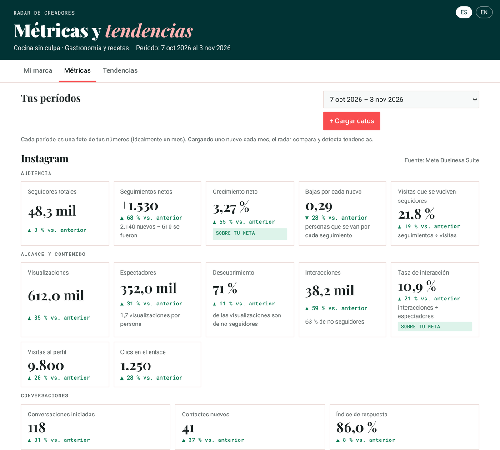

---

## Español

### Dos versiones

| | **Independiente** (raíz del repo) | **Para Claude** (carpeta `claude/`) |
|---|---|---|
| Cómo se abre | Con un link, sin instalar nada | Como artefacto en tu cuenta de claude.ai |
| IA | **Cualquiera** (ChatGPT, Gemini, Copilot, Claude…) en modo copiar y pegar | Claude, automático dentro de la página |
| Dónde se guardan tus datos | En tu navegador, con respaldo descargable | En el espacio privado del artefacto |
| Varias personas | Cada una en su propio navegador | Invitándolas por correo como Editoras |

### Qué hace
- **Mi marca:** documento base con preguntas clave: nicho, audiencia, voz, pilares de contenido, referentes y metas.
- **Métricas:**
  - **Google Search Console:** sube un ZIP por canal (blog, Instagram, TikTok, YouTube) y el radar los separa solo.
  - **Meta Business Suite:** capturas de Estadísticas y de la tabla Contenido.
  - **Cruces:** Google por canal, Google → tus redes, una búsqueda en varios canales, pilares por canal, dónde ganar clics, piezas por formato y por cuenta, comparación con tus metas y con el período anterior.
- **Tendencias:**
  - búsquedas en alza frente al período anterior
  - pilares en el tiempo
  - Google Trends (opcional)
  - tendencias del nicho aterrizadas a tu voz, marcando si salen de *tus datos* o de *conocimiento general*
- **Bilingüe:** botón ES / EN arriba a la derecha.

### Versión independiente: cómo se usa
1. Abre **[alexadarks.github.io/radar-creadores](https://alexadarks.github.io/radar-creadores/)**. También puedes descargar `index.html` y abrirlo en tu computador.
2. Completa **Mi marca** y carga tu primer período en **Métricas**.
3. **Modo copiar y pegar:** cuando el radar necesite IA (leer capturas, ficha de voz, lectura del período, tendencias), abre una ventana con el mensaje listo:
   1. Aprieta **Copiar mensaje** y pégalo en tu IA. Si el radar te lo pide, adjunta también las capturas.
   2. Copia la respuesta completa, pégala en el radar y aprieta **Usar respuesta**.
4. **Respaldo:** tus datos viven en ese navegador. Al final de **Mi marca** está **Descargar respaldo**: hazlo cada mes. Con **Cargar respaldo** recuperas tus datos o los pasas a otro computador.

### Versión para Claude: instalación (5 minutos)
1. Descarga `claude/index.html` y `claude/capabilities.json`.
2. En un chat nuevo de [claude.ai](https://claude.ai), adjunta los dos archivos y pega:
   > Publica `index.html` como un artefacto nuevo llamado "Radar de Creadores", sin modificar el código. Después declara las capacidades exactamente como dice `capabilities.json` (db, user y sample con imágenes).
3. Para compartirlo, invita a cada persona **por correo con nivel Editor** (con el enlace público no se pueden guardar datos). Cada persona ve solo sus propios datos.

### Así se ve el resultado
Ejemplo con una creadora ficticia, *Cocina sin culpa*, y datos inventados.

**Métricas de Meta:** crecimiento neto, descubrimiento, tasa de interacción, comparación con el mes anterior y con tus metas.

**Google por canal:** blog, Instagram, TikTok y YouTube por separado, y cuánto tráfico manda Google a tus redes.
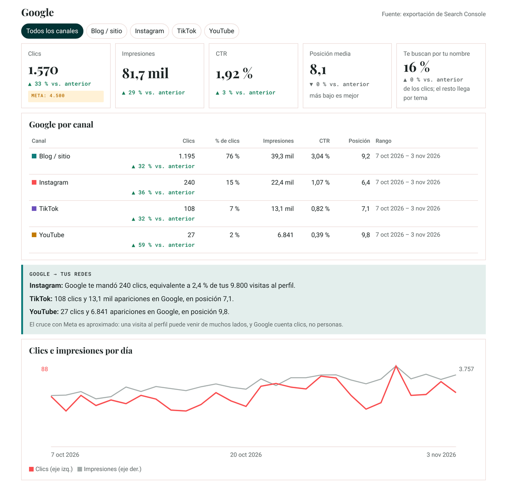

**El cruce:** la misma búsqueda en cada canal, qué tema no tiene artículo, pilares por canal y dónde ganar clics.
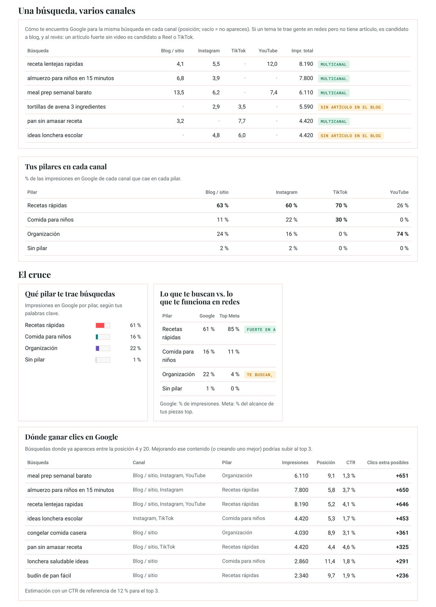

**Tus piezas y lectura del período**, con tres jugadas para el mes siguiente.
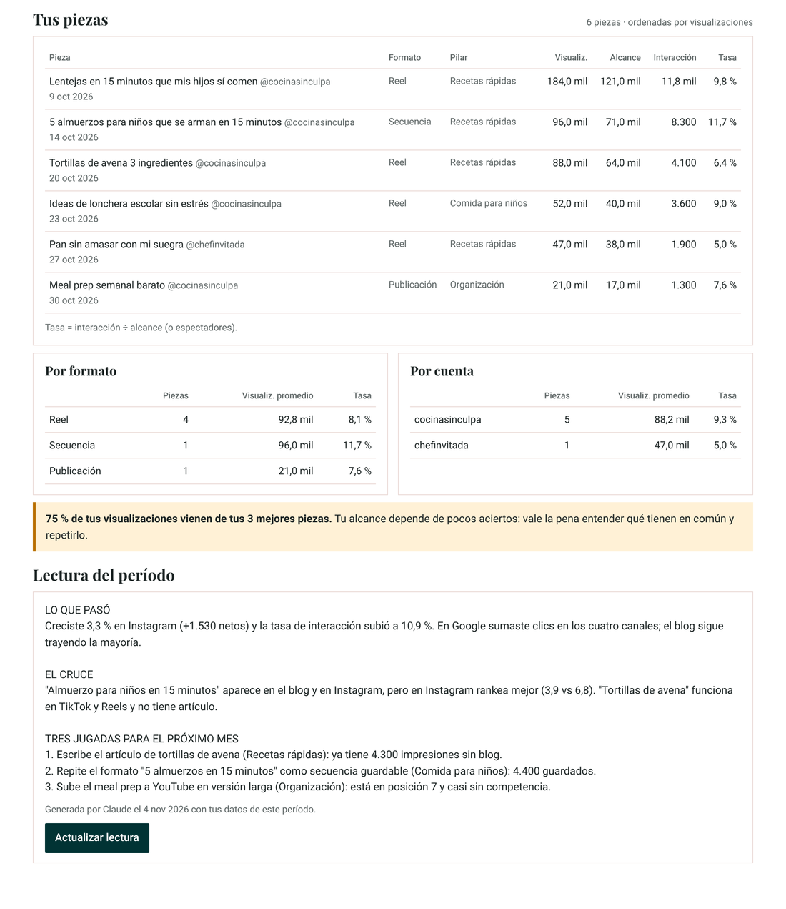

**Tendencias:** búsquedas en alza, pilares en el tiempo, Google Trends y tendencias del nicho con ideas en tu voz.
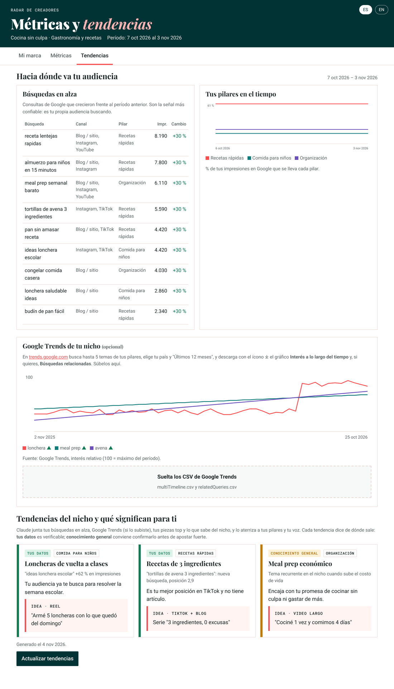

### Qué capturas subir
Imágenes de referencia con **datos ficticios**:

| Qué subir | Ejemplo |
|---|---|
| **Meta → Estadísticas → Rendimiento** (Instagram y Facebook por separado) | 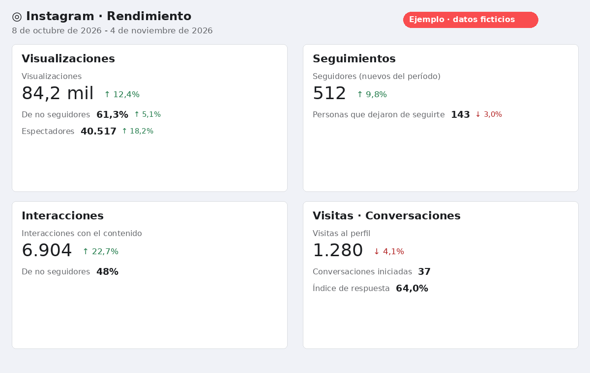 |
| **Meta → Público → Tendencias**: para el total de seguidores. Ojo: en la tarjeta Seguimientos, el número grande son los seguimientos *nuevos* | 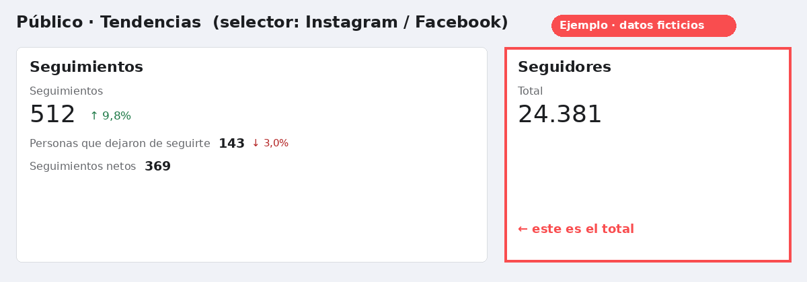 |
| **Meta → Contenido**: la tabla con la fila de títulos visible. Si no se ve, el radar te pregunta qué es cada columna (una sola vez) | 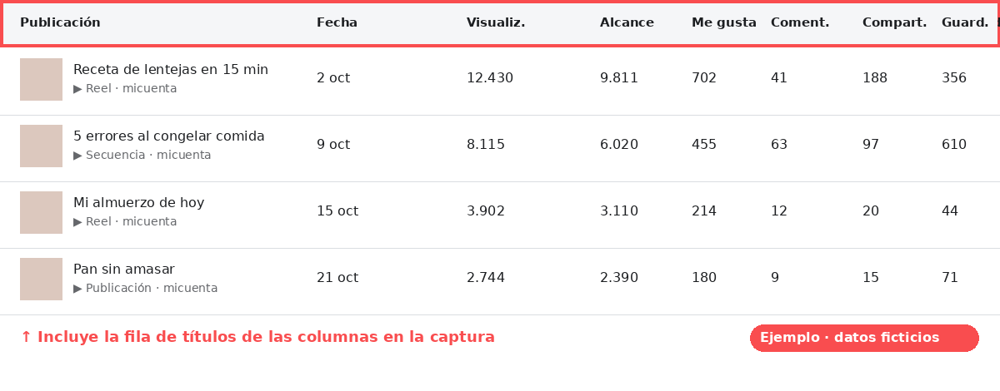 |
| **Search Console → Rendimiento → Exportar → CSV**: un ZIP por canal, con el mismo rango (ej. "Últimos 28 días") | 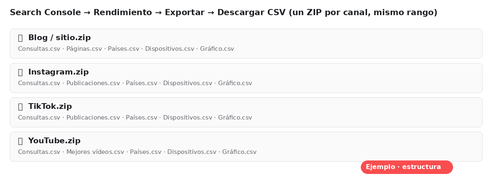 |

### Privacidad
- **Versión independiente:** los datos nunca salen de tu navegador. La IA solo ve lo que tú copias y pegas.
- **Versión para Claude:** los datos quedan en el espacio privado del artefacto; ni la persona dueña de la copia puede verlos.
- Este repo no contiene datos de nadie.

---

## English

### Two versions

| | **Standalone** (repo root) | **For Claude** (`claude/` folder) |
|---|---|---|
| How it opens | From a link, nothing to install | As an artifact in your claude.ai account |
| AI | **Any** (ChatGPT, Gemini, Copilot, Claude…) via copy and paste | Claude, automatic inside the page |
| Where your data lives | In your browser, with a downloadable backup | In the artifact's private space |
| Several people | Each one in their own browser | Invited by email as Editors |

### What it does
- **My brand:** a brand brief with key questions: niche, audience, voice, content pillars, role models and goals.
- **Metrics:**
  - **Google Search Console:** upload one ZIP per channel (blog, Instagram, TikTok, YouTube) and the radar separates them automatically.
  - **Meta Business Suite:** screenshots of Insights and of the Content table.
  - **Cross-checks:** Google by channel, Google → your socials, one search across channels, pillars by channel, where to win clicks, content by format and by account, comparison with your goals and the previous period.
- **Trends:**
  - rising searches vs. the previous period
  - pillars over time
  - Google Trends (optional)
  - niche trends grounded in your voice, labeled as coming from *your data* or *general knowledge*
- **Bilingual:** ES / EN toggle in the top right.

### Standalone: how to use it
1. Open **[alexadarks.github.io/radar-creadores](https://alexadarks.github.io/radar-creadores/)**. You can also download `index.html` and open it on your computer.
2. Fill in **My brand** and load your first period in **Metrics**.
3. **Copy and paste mode:** whenever the radar needs AI (reading screenshots, voice card, period review, trends), it opens a window with the message ready:
   1. Click **Copy message** and paste it into your AI. If the radar asks, attach the screenshots too.
   2. Copy the full answer, paste it back into the radar and click **Use answer**.
4. **Backup:** your data lives in that browser. At the end of **My brand** there's **Download backup**: do it every month. **Load backup** restores your data or moves it to another computer.

### For Claude: install (5 minutes)
1. Download `claude/index.html` and `claude/capabilities.json`.
2. In a new [claude.ai](https://claude.ai) chat, attach both files and paste:
   > Publish `index.html` as a new artifact called "Creator Radar" without changing the code. Then declare its capabilities exactly as in `capabilities.json` (db, user, and sample with images).
3. To share it, invite each person **by email as an Editor** (people using the public link can't save data). Each person only sees their own data.

### What the results look like
Example with a fictional creator, *Cocina sin culpa*, and made-up data.

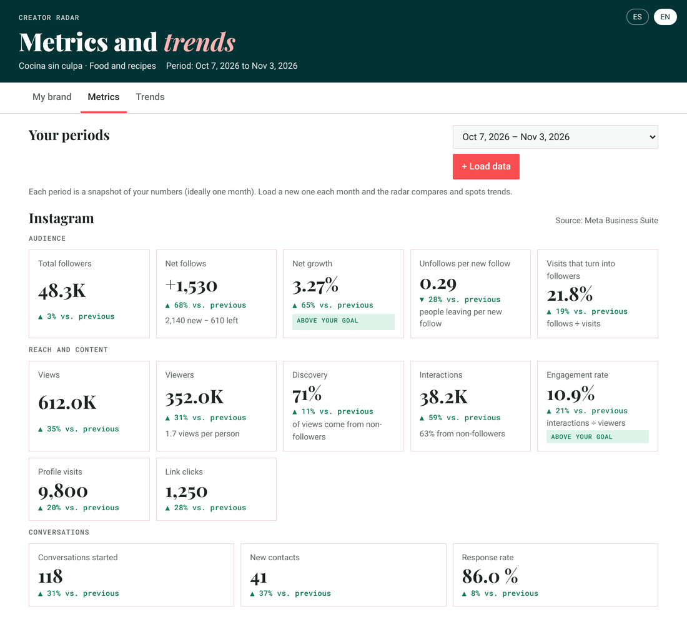
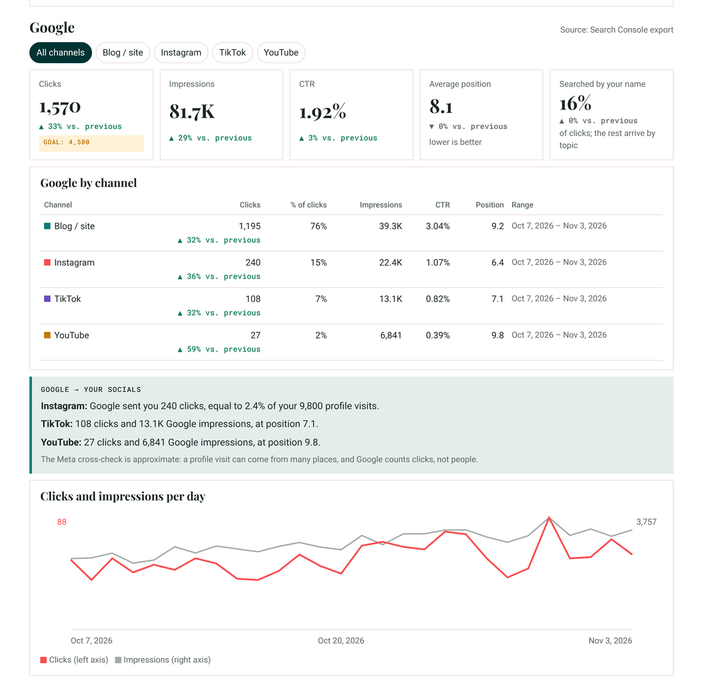

The cross-check, content, review and trend views are shown in Spanish above; the app switches to English with the **EN** button.

### Screenshots to upload
Reference images with **made-up data** (Meta's interface shown in Spanish; in English the cards are Views, Follows, Interactions, Profile visits):

| What to upload | Example |
|---|---|
| **Meta → Insights → Performance** (Instagram and Facebook separately) |  |
| **Meta → Audience → Trends**: for total followers. Note: on the Follows card, the big number is *new* follows |  |
| **Meta → Content**: the table with the header row visible. If it isn't visible, the radar asks you what each column is (once) |  |
| **Search Console → Performance → Export → CSV**: one ZIP per channel, same range (e.g. "Last 28 days") |  |

### Privacy
- **Standalone:** your data never leaves your browser. The AI only sees what you copy and paste.
- **For Claude:** your data stays in the artifact's private space; not even the copy's owner can see it.
- This repo contains no one's data.

---

| Archivo / File | Para qué / Purpose |
|---|---|
| `index.html` | Versión independiente / Standalone version |
| `claude/index.html` | Versión para Claude / Claude version |
| `claude/capabilities.json` | Capacidades del artefacto / Artifact capabilities |
| `ejemplos/` | Capturas de referencia y resultados / Reference screenshots and results |

Licencia / License: MIT
